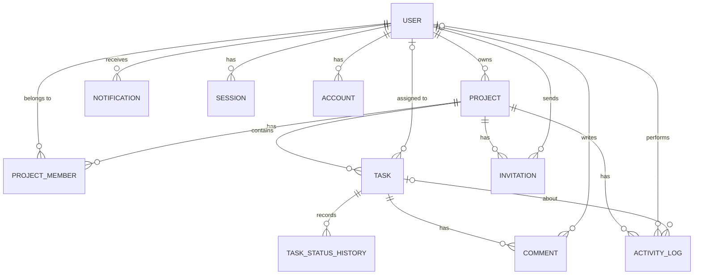

<div align="center">

# FlowForge

**A project and task management app for small teams**

Kanban boards · Roles and permissions · Email invitations · Comments · Activity history

[Live demo](https://flowforge-lac.vercel.app) · [Source](https://github.com/kanchan-px/flowforge) 


</div>

> **Status:** personal portfolio project. It is deployed on Vercel with a Neon PostgreSQL database and has no real traffic. Automated tests and CI are not written yet. See [Roadmap](#roadmap) and [Known limitations](#known-limitations).

---

## Table of contents

- [About](#about)
- [Try it](#try-it)
- [Features](#features)
- [Tech stack](#tech-stack)
- [Architecture](#architecture)
- [Roles and permissions](#roles-and-permissions)
- [Data model](#data-model)
- [Engineering decisions](#engineering-decisions)
- [Project structure](#project-structure)
- [Getting started](#getting-started)
- [Environment variables](#environment-variables)
- [Scripts](#scripts)
- [Deployment](#deployment)
- [Testing](#testing)
- [What I learned](#what-i-learned)
- [Author](#author)

---

## About

FlowForge lets a team plan and track work in one place. You create a project, invite teammates by email, add tasks, assign them, move them across a Kanban board, discuss them in comments, and see a history of who changed what.

I built it to go beyond a basic CRUD app. The interesting parts are on the backend: permission checks that run on the server on every write, a team model added on top of a single-owner schema without breaking it, safe handling of concurrent updates and failed emails, and account flows (Google sign-in, verification, re-authentication before deletion) that handle edge cases.

---

## Try it

**Live demo:** https://flowforge-lac.vercel.app

**Shared demo account with sample data:**

| | |
|---|---|
| Email | `a91894410@gmail.com` |
| Password | `test@123` |

**This is a public login, so please don't change the password or delete the account. You can also sign up with your own email, or with Google.**

**Invitation emails only reach the project owner's address on the demo, because the email provider is still in test mode .**

---

## Features

### Projects and tasks
- Create, edit and delete projects. Each has a name, description, owner and members.
- Tasks with status (To Do, In Progress, Done), priority, due date and assignee.
- A project workspace with five tabs: **Overview**, **Board**, **List**, **Members** and **Activity**. The active tab is kept in the URL.
- A drag-and-drop **Kanban board** with instant (optimistic) updates and keyboard support.
- A cross-project task list with filtering, debounced search, sorting and server-side pagination.
- Overdue highlighting on cards and the board.
- A dashboard with live statistics and recent activity, and an **analytics** page with completion rate, status and priority breakdown, per-project progress and a 7 or 30 day productivity trend.

### Collaboration
- **Members and roles:** Owner, Admin and Member, enforced on the server.
- **Email invitations** with expiring links. People can accept or decline from an Invitations page, and owners can revoke pending invites.
- **Task assignees**, limited to members of the task's project.
- **Task comments** with edit and delete rules based on role.
- A per-project **activity feed** showing who changed what and when, with "load more" pagination.
- **In-app notifications** with unread count, mark as read, and per-user preferences.

### Accounts and security
- Email and password sign-up and sign-in, plus **Google OAuth** with account linking.
- **Email verification**, switched on with an environment variable.
- Profile editing and profile photo upload (Cloudinary).
- Password change that signs out other sessions.
- **Account deletion** that asks for the password, or a fresh Google sign-in for Google-only accounts. The server checks both.

---

## Tech stack

| Layer | Technology |
|---|---|
| Framework | Next.js 16 (App Router), React 19 |
| Language | TypeScript |
| Styling and UI | Tailwind CSS v4, shadcn/ui, Base UI primitives, Lucide icons |
| Forms and validation | React Hook Form, Zod (same schemas on client and server) |
| Drag and drop | dnd-kit |
| Backend | Next.js Server Components and Server Actions |
| Database | PostgreSQL (Neon) with Prisma 6 |
| Authentication | Better Auth (email and password, Google OAuth) |
| Email | Resend |
| Images | Cloudinary |
| Notifications UI | Sonner |
| Hosting | Vercel |

---

## Architecture

The app uses a server-first design. There is no separate API server. Reads happen in Server Components and writes happen in Server Actions.

```
Browser (React)
   │  form submit / click
   ▼
Server Action ──► read session (Better Auth)
   │              validate input (Zod)
   │              check role / ownership
   ▼
Prisma ──► PostgreSQL (Neon)
   │
   ▼
revalidatePath() ──► fresh Server Component render
```

Every write follows the same steps:

1. Authenticate the user from the session cookie.
2. Validate the input with Zod.
3. Load the resource on the server. The browser sends only IDs.
4. Check the caller's role in that project.
5. Write to the database, using a transaction when several rows change together.
6. Record activity and send notifications as a best effort, so they never fail the main action.
7. Revalidate the affected pages.

---

## Roles and permissions

| Action | Owner | Admin | Member |
|---|:---:|:---:|:---:|
| View project, tasks, members, activity | ✅ | ✅ | ✅ |
| Create, edit, delete and move tasks | ✅ | ✅ | ✅ |
| Assign tasks to members | ✅ | ✅ | ✅ |
| Comment on tasks | ✅ | ✅ | ✅ |
| Edit own comments | ✅ | ✅ | ✅ |
| Delete comments | any | any | own only |
| Invite members | as Admin or Member | as Member only | ❌ |
| Revoke pending invitations | ✅ | ✅ | ❌ |
| Remove members | any non-owner | Members only | ❌ |
| Change member roles | ✅ | ❌ | ❌ |
| Edit or delete the project | ✅ | ❌ | ❌ |
| Leave the project | ❌ | ✅ | ✅ |

These rules live in Server Actions. Hidden buttons in the UI are a convenience, not the protection.

---

## Data model



Better Auth also manages a `verification` table.

Delete behaviour:
- Deleting a **project** removes its tasks, comments, members, invitations and activity.
- Deleting a **user** removes their sessions, accounts, owned projects and notifications. Their comments and activity entries stay, shown as "Deleted user".
- Deleting a **task** removes its comments and status history. Its activity entries stay, because names are stored as text.
- Removing a **member** unassigns their tasks in that project.

---

## Engineering decisions

- **Additive schema changes.** Team support came from a new `ProjectMember` table alongside `Project.ownerId`, so the existing owner checks kept working. A one-time, idempotent script created owner memberships for existing projects.
- **Send-before-persist for invitations.** The email goes out first and the invitation is saved only if it succeeds. A failed send never leaves a dead invitation. Accepting an invitation is idempotent and uses a transaction.
- **Concurrency guard on board moves.** A task moves only if it is still in the status the server read. That update and the history row happen in one transaction, so two people dragging the same card can't both win.
- **Optimistic UI without stale copies.** The board shows server data plus any pending move, using `useOptimistic`, instead of copying props into its own state.
- **Activity log stores snapshots.** Task and member names are saved as text, so history stays readable after renames and deletions. The feed uses cursor pagination, so new entries don't shift the pages.
- **Best-effort side effects.** Activity logging and notifications never throw into the main action.
- **Sensitive actions re-check the database.** Deleting a Google-only account needs a Google sign-in that happened after the user clicked "Confirm with Google". The server compares session time to a stored marker, not a form flag.
- **No information leaks.** Missing and forbidden resources return the same message, and only needed user fields (id, name) go to the browser.
- **URL as state.** Filters, pages and project tabs live in the address bar, so refresh, back and shared links work.
- **Configuration through the environment.** Trusted origins, base URL and the verification switch come from environment variables, so one codebase runs locally and in production.

---

## Project structure

```
app/                       routes and layouts (App Router)
  (auth)/                  sign-in, sign-up, verify-email
  (dashboard)/             workspace, projects, tasks, analytics,
                           invitations, settings
  invite/[token]/          public invitation page
  api/auth/[...all]/       Better Auth handler
components/                shared UI (shadcn/ui, navbar, sidebar)
features/
  activity/  analytics/  auth/  comments/  invitations/  landing/
  members/   notifications/  projects/  search/  settings/  tasks/
  workspace/
    actions/               Server Actions (writes)
    queries/               server-side reads
    components/            feature UI
    schemas/               Zod schemas
lib/                       auth, auth-client, prisma, resend,
                           cloudinary, session
prisma/                    schema.prisma and migrations
```

---

## Getting started

### Prerequisites
- Node.js 18 or newer
- A PostgreSQL database ([Neon](https://neon.tech) has a free tier)
- Accounts for [Resend](https://resend.com), [Google Cloud](https://console.cloud.google.com) (OAuth client) and [Cloudinary](https://cloudinary.com)

### Setup

```bash
git clone https://github.com/kanchan-px/flowforge.git
cd flowforge
npm install          # also runs `prisma generate`
cp .env.example .env.local   # or create .env.local by hand
```

Fill in `.env.local` (see below), then:

```bash
npx prisma migrate dev
npm run dev
```

Open http://localhost:3000.

For Google sign-in, create an OAuth client and add `http://localhost:3000/api/auth/callback/google` as an authorized redirect URI.

---

## Environment variables

| Variable | Required | Purpose |
|---|:---:|---|
| `DATABASE_URL` | ✅ | PostgreSQL connection string |
| `BETTER_AUTH_SECRET` | ✅ | Random secret for signing sessions (`openssl rand -hex 32`) |
| `BETTER_AUTH_URL` | ✅ | Site address, for example `http://localhost:3000` |
| `NEXT_PUBLIC_APP_URL` | ✅ | Same address. Used to build invitation links |
| `RESEND_API_KEY` | ✅ | Resend API key |
| `FROM_EMAIL` | ✅ | Sender address (`onboarding@resend.dev` for testing) |
| `GOOGLE_CLIENT_ID` / `GOOGLE_CLIENT_SECRET` | ✅ | Google OAuth credentials |
| Cloudinary variables | ✅ | See `lib/cloudinary.ts` for the exact names |
| `REQUIRE_EMAIL_VERIFICATION` | ❌ | Set to `true` to require verified emails before sign-in |

Never commit real values. `.env*` files are ignored by Git.

---

## Scripts

| Command | What it does |
|---|---|
| `npm run dev` | Start the development server |
| `npm run build` | Production build |
| `npm run start` | Run the production build |
| `npm run lint` | Run ESLint |
| `npx prisma migrate dev` | Create and apply migrations (local database only) |
| `npx prisma migrate deploy` | Apply existing migrations (use this for production) |
| `npx prisma studio` | Browse the database |

---

## Deployment

- Hosted on **Vercel**, with a separate **Neon** database for the live site.
- Environment variables are set in the Vercel dashboard. After changing one, redeploy.
- A `postinstall` script runs `prisma generate`, so a build never uses a stale Prisma client.
- Migrations are not run by the build. Apply them with `prisma migrate deploy` against the production database before shipping code that needs them.
- Google sign-in needs the production origin and redirect URI added in Google Cloud.

---

## What I learned

- Why authorization has to be checked in every server write, and why a hidden button isn't a permission.
- How to extend a working schema without breaking existing behaviour, and how to migrate existing data safely.
- How to design for failure: emails that fail, requests that arrive twice, users who are removed mid-session.
- Optimistic concurrency, transactions, idempotency and cursor pagination, and when each is needed.
- How OAuth, account linking and re-authentication fit together, and how a project's configuration changes between local and production.

---

## Author

**Kanchan**
GitHub: [@kanchan-px](https://github.com/kanchan-px)

Feedback and questions are welcome through GitHub issues.